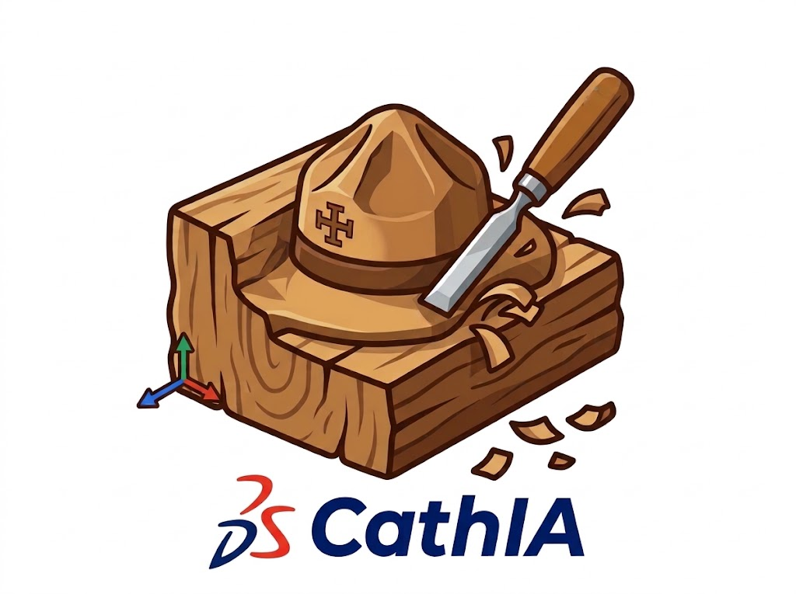

<p align="center">
  
</p>

<h1 align="center"><b style="color:#000761">SO</b><b style="color:#d9232d">LEAD</b><span style="color:#000761">WORKS</span></h1>

<p align="center">
  <strong>Conception 3D de meubles et de coins de patrouille pour le camp scout.</strong><br />
  Un meuble = un plan (vues cotées, liste de débit, assemblages, ordre de montage).<br />
  Un coin de patrouille = une vue d'ensemble, et un plan pour chaque meuble.
</p>

SoLeadWorks est l'alternative « de fond » à **CathIA** : même objectif (le froissartage : bois rond,
tenons, mi-bois, claies, brêlages), mais construite sur le noyau complet de
[SolidCraft](https://github.com/tangency-labs/solidcraft) (Rust, esquisses contraintes, noyau B-rep,
historique paramétrique, assemblages, nomenclature) **allégé à l'extrême** : tout ce qui sert à la
tôlerie, au plastique, aux surfaces, aux maillages, à l'animation mécanique, au rendu ou à l'usinage
a été retiré.

## Les ateliers (comme CathIA)

Le ruban reprend les onglets de CathIA, avec des icônes dessinées pour chaque fonction :

| Onglet | Contenu |
|---|---|
| **Édition** | annuler / rétablir, points de retour (historique), déplacer-copier, répétitions, symétrie, supprimer, grouper, collisions, mesure, coupe |
| **Créer** | **Nouveau meuble** (les 11 modèles de CathIA, réglables) et coin de patrouille ; traverse, équerre, plateau de claies, filet |
| **Opérations** | **Façonner** : fendre, quart de bois, couper, pointe. **Assemblages** : tenon et mortaise (hachette, scié, plat, plat scié), mi-bois, queue d'aronde (3 types), chevilles, brêlage. Booléens |
| **Formes** | bloc, cylindre, tube rond, sphère, cône ; tube carré, cornière, U, poutre en I |
| **Esquisse** | esquisse contrainte et cotée, extrusion, révolution, trou, congés et chanfreins |
| **Plans** | **Dessin technique** (feuille A3/A4, vues, échelle, cotes, cartouche, export SVG), export HTML, vue éclatée du montage |
| **Nomenclature** | pièces, assemblages et liste de matériel, export CSV |

Un **meuble** donne un plan par meuble ; un **coin de patrouille** range plusieurs meubles au sol et a sa
vue d'ensemble. L'historique de SolidCraft (frise, marqueur, points de retour) est conservé.

Toutes les fonctions passent par `Session::execute` : ruban, palette de commandes, scripts, CLI, MCP.
`scout.meuble.create`, `scout.assemblage`, `scout.faconner`, `scout.piece.*`, `scout.profil`,
`scout.coin.create`, `scout.atelier.dessin`, `scout.atelier.nomenclature`, `scout.export.html`.

## Construire

```
cargo test -p solidcraft-engine --lib scout      # moteur + plans
cd apps/solidcraft-web && trunk build --release  # application web (dist/web)
```

Voir `docs/SOLEADWORKS.md` pour la feuille de route, ce qui a été retiré et ce qui reste à retirer.

## Licence

MIT OU Apache-2.0 (voir `LICENSE-MIT`, `LICENSE-APACHE`, `NOTICE`). Les dépendances sont listées dans
`THIRD-PARTY-LICENSES.txt`.
